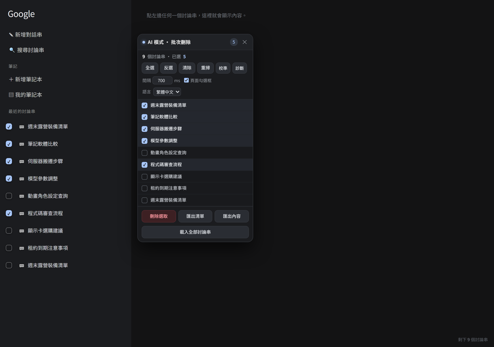

# google-ai-mode-bulk-delete

[繁體中文](README.md) ｜ [简体中文](README.zh-CN.md) ｜ **English**

A free Chrome extension for **bulk-deleting** threads and **exporting conversations** in Google AI Mode — no ads, no paywall, no limits.

Every feature that other extensions charge for is implemented here from scratch.



## Features

- **Bulk delete threads** — tick the ones you want, or select all. Duplicate titles are handled correctly
  (rows are identified by `data-thread-id`, so nothing is skipped or deleted by mistake)
- **Export the thread list** — `.txt`, one entry per line
- **Export conversation contents** — selected only or everything; source cards and right-rail ad text are
  stripped automatically, and Simplified Chinese is converted to Traditional
- **Export as JSON** — keeps paragraph structure and links
- **UI language** — Traditional Chinese / Simplified Chinese / English
- **Stop anytime** — long batches can be interrupted, and everything deleted so far is logged

## Install (unpacked)

1. Download this repo (or the zip from Releases) and extract it
2. Open `chrome://extensions` and turn on **Developer mode** (top right)
3. Click **Load unpacked** and pick the `ai-mode-bulk-delete` folder
4. Open Google AI Mode — the panel appears in the top-right corner
   (If you see no threads, click the menu button at the top-left to expand "Recent" threads)

## Project layout

```
ai-mode-bulk-delete/     the extension itself (manifest, content script, popup)
  content/content.js     main logic: detect rows, select, delete, capture, export
  content/i18n.js        strings for the three languages
  content/s2t.js         Simplified → Traditional (OpenCC tables)
  test/                  end-to-end tests (headless Chrome) and a fixture page
```

## Testing

```powershell
cd ai-mode-bulk-delete
node test/run-test.js
```

Runs the whole flow in a real headless Chrome with the extension loaded — about 85 checks.

## License

MIT — see [LICENSE](LICENSE).
