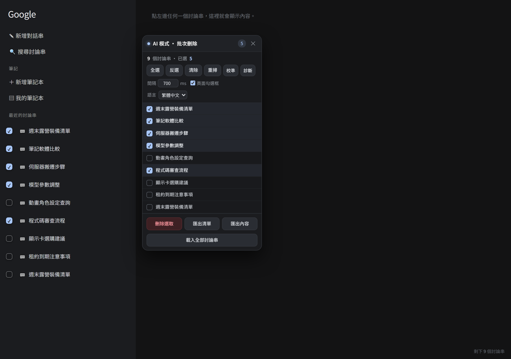

# google-ai-mode-bulk-delete

**繁體中文** ｜ [简体中文](README.zh-CN.md) ｜ [English](README.en.md)

Google AI 模式（AI Mode）的**批次刪除**與**內容匯出** Chrome 擴充功能，免費、無廣告、沒有任何數量上限。

原本要付費解鎖的功能，這裡全部自己實作。



## 功能

- **批次刪除討論串**：勾選要刪的、可一鍵全選，支援同名討論串（用 `data-thread-id` 當識別，不會漏刪誤刪）
- **匯出討論串清單**：`.txt`，一行一則
- **匯出討論串內容**：可只匯出勾選的、或全部；自動去掉來源卡片與右側廣告文字，簡體轉繁體
- **匯出成 JSON**：保留段落結構與連結
- **介面語言**：繁體中文 / 简体中文 / English 三語切換
- **可中途停止**打斷長批次，刪到哪都有紀錄

## 安裝（開發者模式）

1. 下載這個 repo（或 Releases 的 zip）並解壓縮
2. 打開 `chrome://extensions`，右上角開啟「開發人員模式」
3. 按「載入未封裝項目」，選擇 `ai-mode-bulk-delete` 資料夾
4. 到 Google AI 模式頁面，右上角會出現面板
   （看不到討論串的話，點左上角的選單鈕把「最近的討論串」展開）

## 專案結構

```
ai-mode-bulk-delete/     擴充功能本體（manifest、content script、popup）
  content/content.js     主要邏輯：偵測討論串、勾選、刪除、抓內容、匯出
  content/i18n.js        三語字串
  content/s2t.js         簡體轉繁體（OpenCC 對照表）
  test/                  端到端測試（headless Chrome）與測試用假頁面
```

## 測試

```powershell
cd ai-mode-bulk-delete
node test/run-test.js
```

用真的 Chrome（headless）載入擴充功能跑完整流程，約 85 項檢查。

## 授權

MIT，詳細條文見 [LICENSE](LICENSE)。
