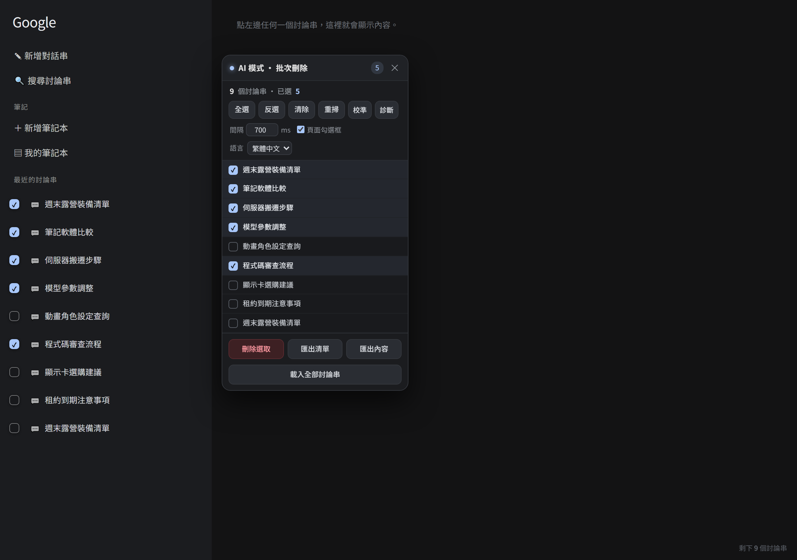

# google-ai-mode-bulk-delete

[繁體中文](README.md) ｜ **简体中文** ｜ [English](README.en.md)

Google AI 模式（AI Mode）的**批量删除**与**内容导出** Chrome 扩展程序，免费、无广告、没有任何数量上限。

原本要付费才能解锁的功能，这里全部自己实现。



## 功能

- **批量删除对话串**：勾选要删的、可一键全选，支持同名对话串（用 `data-thread-id` 当识别，不会漏删误删）
- **导出对话串清单**：`.txt`，一行一则
- **导出对话串内容**：可只导出勾选的、或全部；自动去掉来源卡片与右侧广告文字，简体转繁体
- **导出成 JSON**：保留段落结构与链接
- **界面语言**：繁體中文 / 简体中文 / English 三语切换
- **可中途停止**打断长批次，删到哪都有记录

## 安装（开发者模式）

1. 下载这个 repo（或 Releases 里的 zip）并解压缩
2. 打开 `chrome://extensions`，右上角开启「开发者模式」
3. 按「加载已解压的扩展程序」，选择 `ai-mode-bulk-delete` 文件夹
4. 到 Google AI 模式页面，右上角会出现面板
   （看不到对话串的话，点左上角的菜单按钮把「最近的对话」展开）

## 项目结构

```
ai-mode-bulk-delete/     扩展程序本体（manifest、content script、popup）
  content/content.js     主要逻辑：侦测对话串、勾选、删除、抓内容、导出
  content/i18n.js        三语字符串
  content/s2t.js         简体转繁体（OpenCC 对照表）
  test/                  端到端测试（headless Chrome）与测试用假页面
```

## 测试

```powershell
cd ai-mode-bulk-delete
node test/run-test.js
```

用真正的 Chrome（headless）加载扩展程序跑完整流程，约 85 项检查。

## 授权

MIT，详细条文见 [LICENSE](LICENSE)。
